# Mod Organizer 2 Stylesheets

## Description

A collection of my custom stylesheets for Mod Organizer 2, shared for anyone who wants to change the look of their mod manager.

## Themes

The following themes are included in `stylesheets` with centered context-menu
icons and checkmarks.   Their original styling and attribution are preserved.

- `+GitHub.qss`
- `+Sayngwyn Red.qss`
- `+Slate Teal.qss`
- `+Steam.qss`

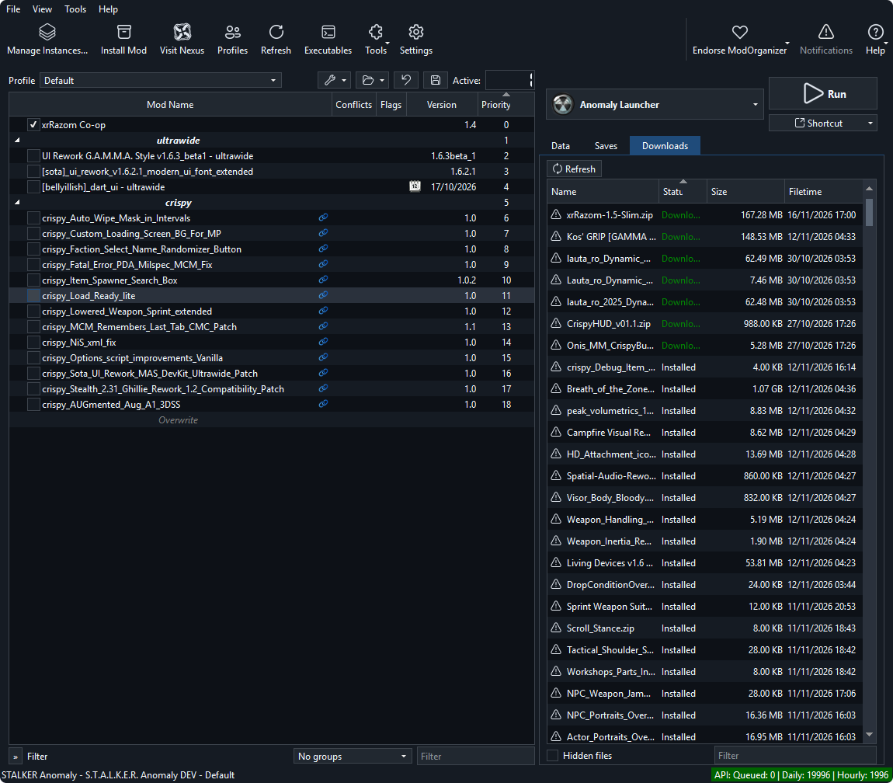 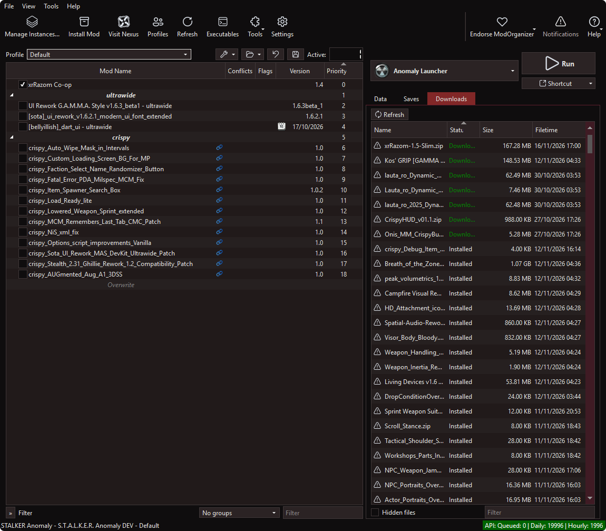
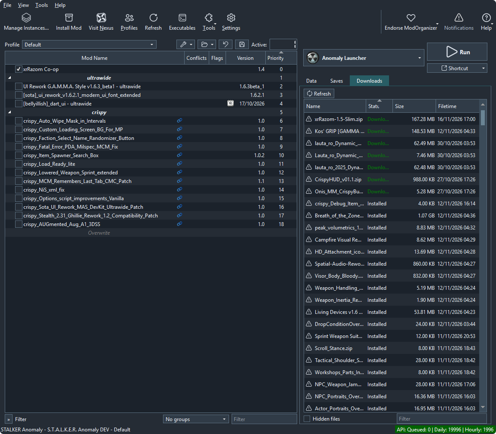 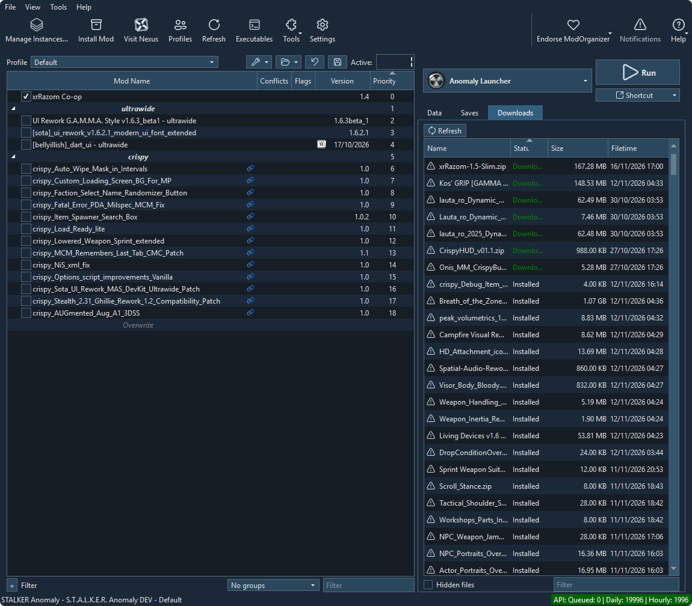

 

- `Night Eyes+ GitHub.qss`
- `Night Eyes+ Contrast.qss`
- `Night Eyes+ Slate Teal.qss`
- `Night Eyes+ Steam.qss`

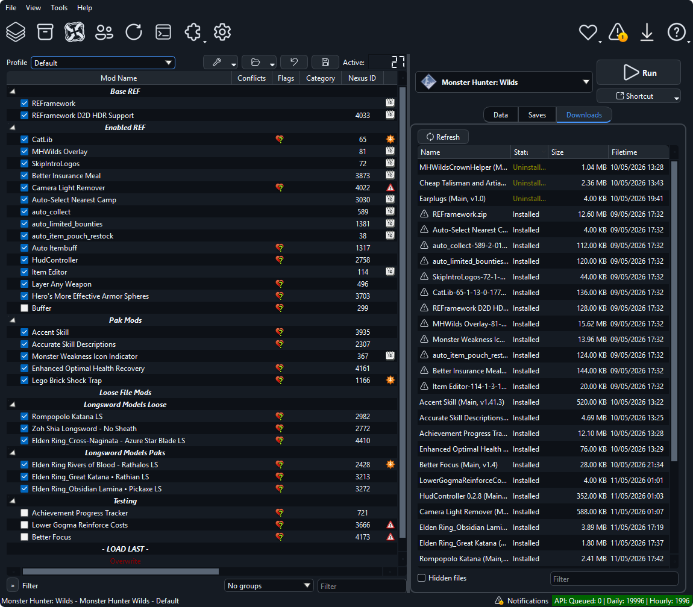 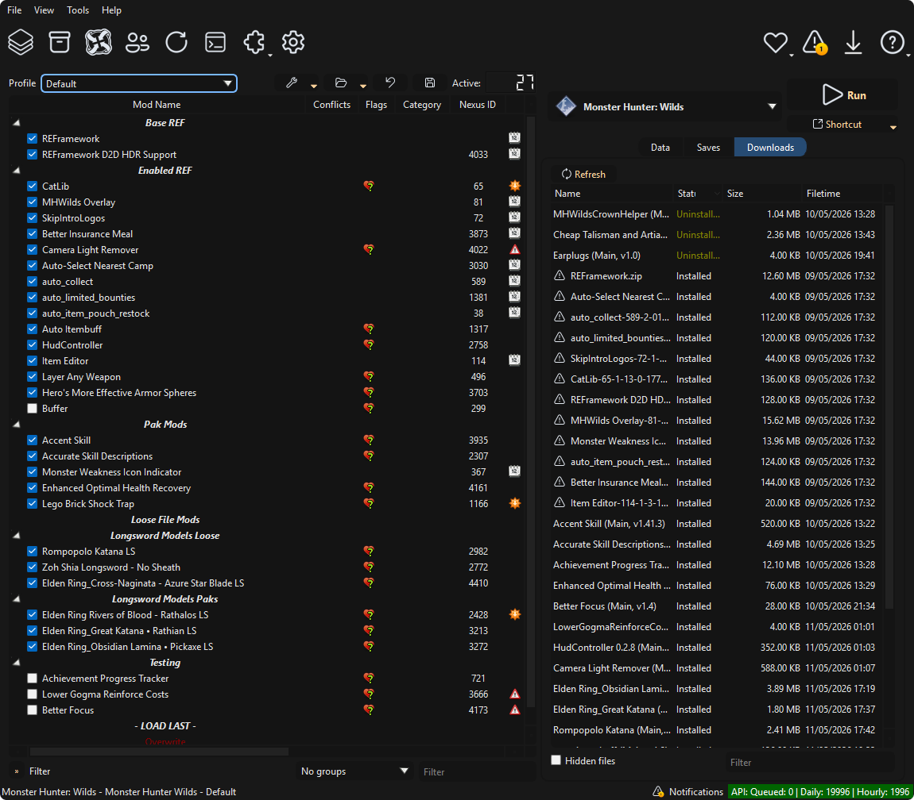
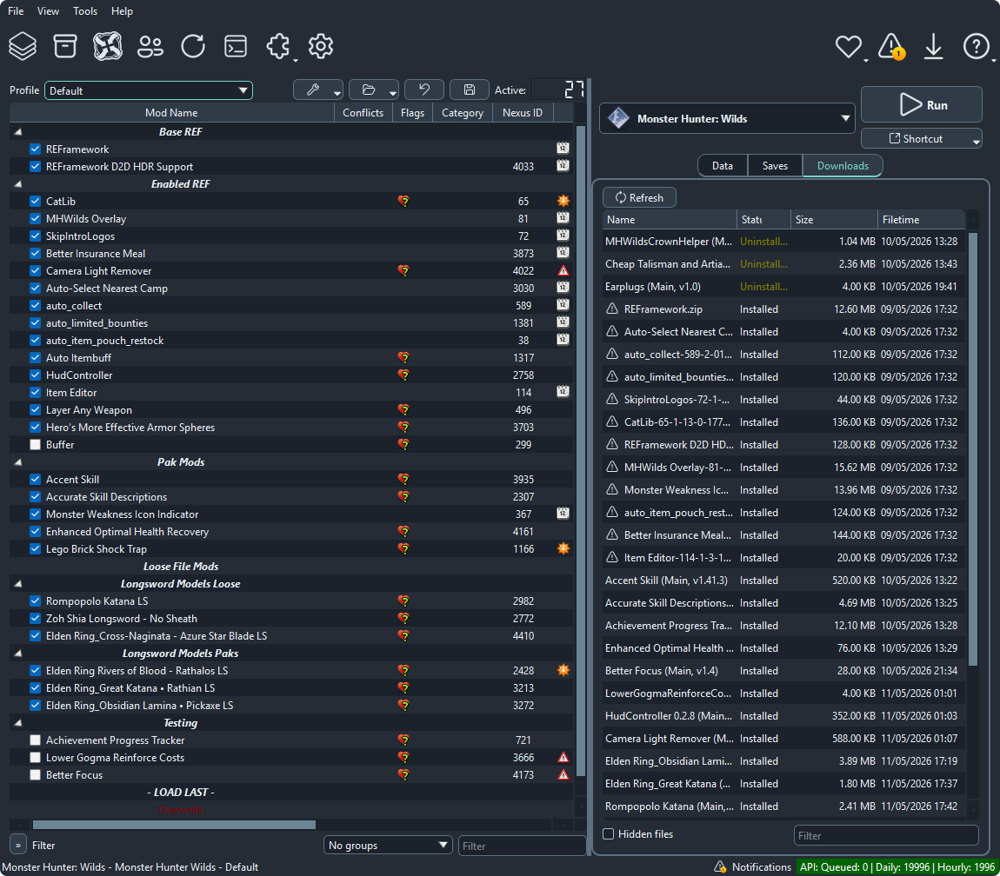 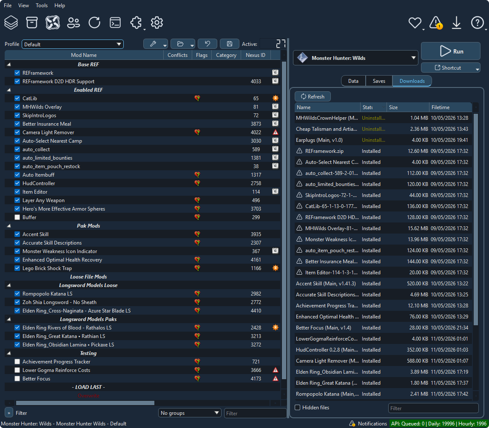 

 

- `vs15 Dark+ GitHub.qss`
- `vs15 Dark+ Slate Teal.qss`
- `vs15 Dark+ Steam.qss`

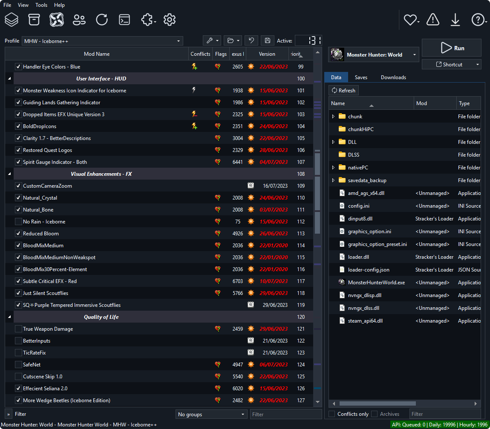 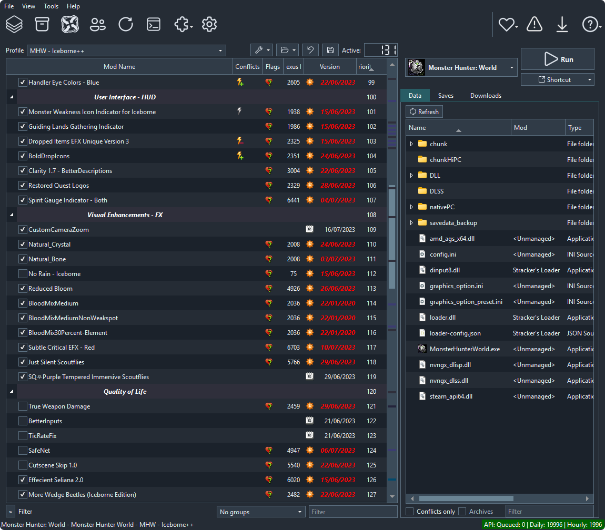 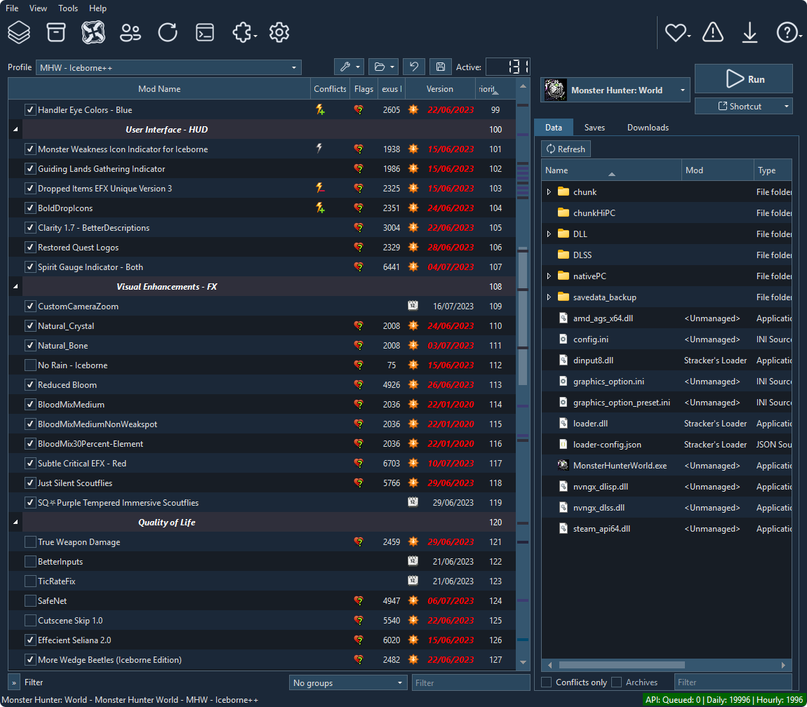

## Features

- Log, Toolbars and Exit menu icons; Shortcut icons and missing tool-plugin fallback icons through the helper.

## Requirements

Mod Organizer 2.5.2

## Installation

1. Close Mod Organizer 2 and back up stylesheet or asset folders you intend to replace.
2. Copy the bundle's `stylesheets` contents into MO2's `stylesheets` folder, keeping the folder structure.
3. Copy `plugins/mo2_icons_menu.py` into MO2's `plugins` folder.
4. Start MO2 and select the desired stylesheet in Settings > Theme.

## Credits

- **Sayngwyn by Sayngwyn:** https://www.nexusmods.com/site/mods/2487
- **Night Eyes by Ciathyza:** https://github.com/ciathyza/mo2-themes.
- **vs15 Dark preview controls:** chintsu_kun, holt59 and the MO2 Team: https://github.com/nikolay-borzov/modorganizer-themes
- **Microsoft Fluent System Icons:** Their license texts are retained in `licenses/`.

Original licenses, credits and restrictions continue to apply to their respective assets.

---

made with ❤️ by SavageBulldogOG
